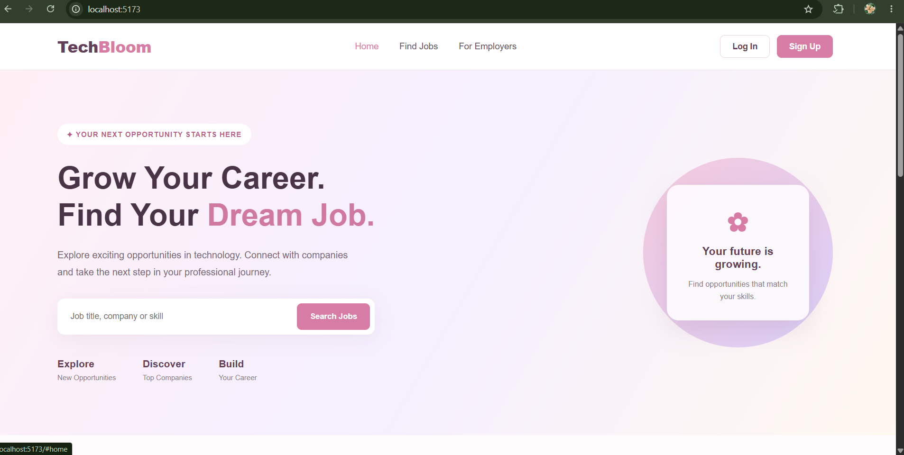
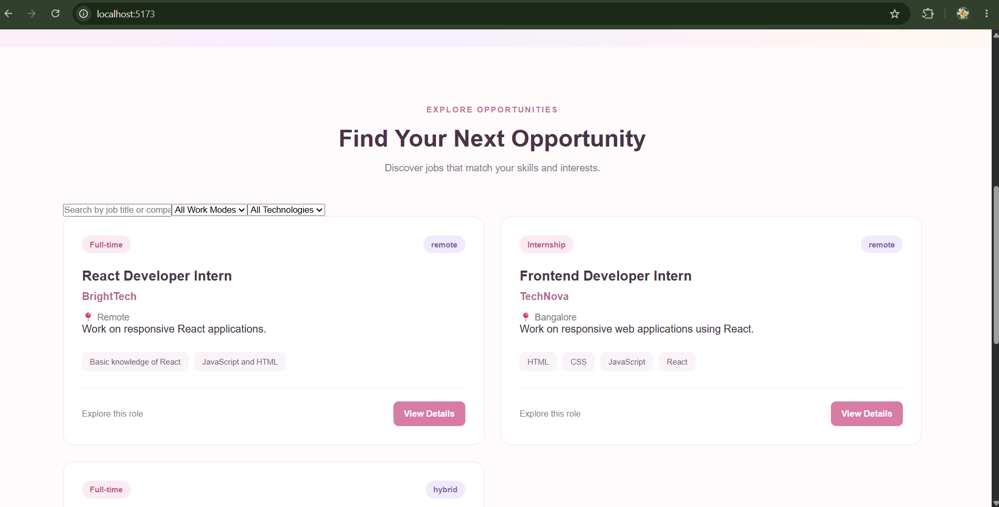
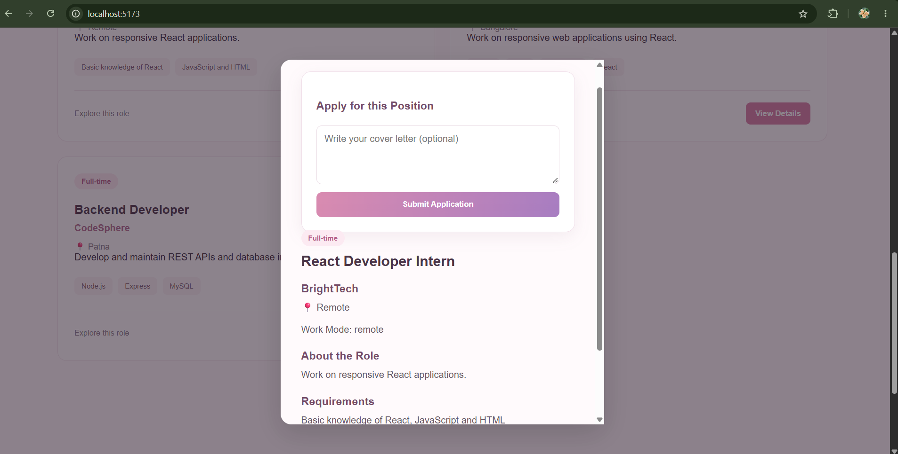
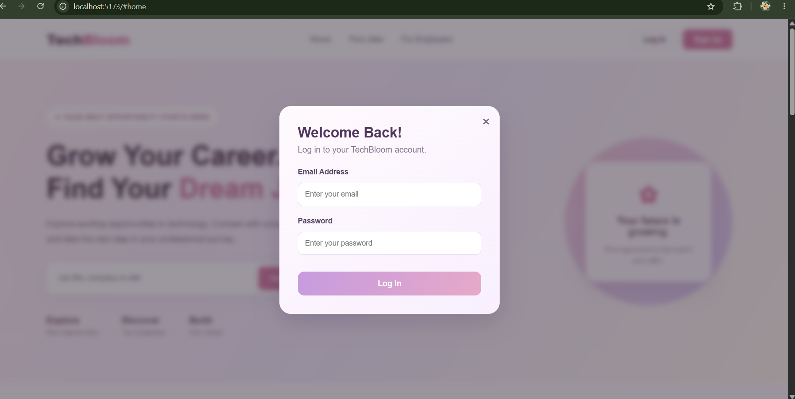
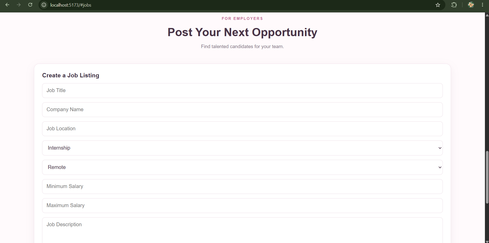
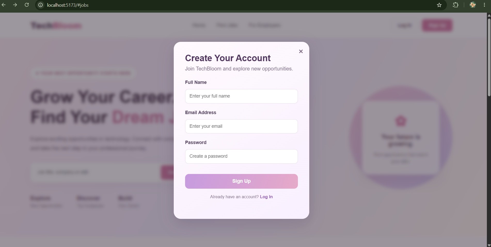

# TechBloom – Tech Job Board & Candidate Portal

TechBloom is a full-stack job board platform that connects employers with candidates. Employers can post job openings, while candidates can browse jobs, filter by location and technology tags, and submit applications.

## Screenshots

| Homepage | Job Listings |
|---|---|
|  |  |

| Job Details | Candidate Login |
|---|---|
|  |  |

| Employer Dashboard | Candidate Signup |
|---|---|
|  |  |

## Features

- **Job Posting:** Employers can create, update, and delete job listings.
- **Job Search & Filters:** Search jobs by supported fields, work mode (Remote/Hybrid), and technology tags.
- **Candidate Authentication:** Candidate registration and login.
- **Job Applications:** Candidates can apply for jobs and view their application history.
- **Employer Dashboard:** Employers can manage job listings, view applicants, and update application statuses.
- **Database Persistence:** MySQL stores jobs, candidates, tags, and applications.
- **Secure Access:** JWT authentication and role-based authorization.

## Tech Stack

- **Frontend:** React, Vite, CSS, JavaScript
- **Backend:** Node.js, Express.js
- **Database:** MySQL
- **Authentication:** JWT, bcrypt

## Project Structure

```text
tech-job-board/
├── backend/
│   ├── config/
│   ├── controllers/
│   ├── middleware/
│   ├── routes/
│   └── server.js
├── frontend/
│   └── src/
├── database/
│   └── techbloom_schema.sql
├── screenshots/
└── README.md
```

## Installation & Setup

**Prerequisites:** Node.js, npm, and MySQL.

### 1. Clone the repository

```bash
git clone https://github.com/Ayushi2808/techbloom-job-board.git
cd techbloom-job-board
```

### 2. Set up the database

Create the database:

```sql
CREATE DATABASE techbloom;
```

Import `database/techbloom_schema.sql` into the `techbloom` database.

### 3. Start the backend

```bash
cd backend
npm install
```

Create a `.env` file inside the backend folder:

```env
PORT=5000
DB_HOST=localhost
DB_USER=root
DB_PASSWORD=your_mysql_password
DB_NAME=techbloom
DB_PORT=3306
JWT_SECRET=your_secret_key
EMPLOYER_EMAIL=your_employer_email
EMPLOYER_PASSWORD_HASH=your_bcrypt_password_hash
```

Start the backend:

```bash
npm run dev
```

Backend URL: `http://localhost:5000`

### 4. Start the frontend

Open another terminal:

```bash
cd frontend
npm install
npm run dev
```

Frontend URL: `http://localhost:5173`

**Note:** Never commit your `.env` file, database credentials, or authentication secrets to GitHub.

## Database Model

TechBloom uses five relational tables:

| Table | Description |
|---|---|
| `jobs` | Stores job listings |
| `candidates` | Stores candidate account and profile details |
| `tags` | Stores technology tags |
| `job_tags` | Connects jobs with technology tags |
| `applications` | Stores candidate job applications |

### Relationships

- `applications.candidate_id` → `candidates.candidate_id`
- `applications.job_id` → `jobs.job_id`
- `job_tags.job_id` → `jobs.job_id`
- `job_tags.tag_id` → `tags.tag_id`

These foreign keys maintain relationships between jobs, candidates, tags, and applications.

## API Overview

Base URL: `http://localhost:5000`

| Method | Endpoint | Purpose |
|---|---|---|
| POST | `/api/candidates/register` | Candidate registration |
| POST | `/api/candidates/login` | Candidate login |
| POST | `/api/employer/login` | Employer login |
| GET | `/api/jobs` | Get and filter jobs |
| GET | `/api/jobs/:id` | Get job details |
| POST | `/api/jobs` | Create a job |
| PUT | `/api/jobs/:id` | Update a job |
| DELETE | `/api/jobs/:id` | Delete a job |
| GET | `/api/tags` | Get technology tags |
| POST | `/api/tags` | Create a technology tag |
| GET | `/api/candidates/:id` | Get candidate profile |
| PUT | `/api/candidates/:id` | Update candidate profile |
| POST | `/api/applications/jobs/:jobId/apply` | Apply for a job |
| GET | `/api/applications/candidate/:candidateId` | View candidate applications |
| GET | `/api/applications/jobs/:jobId/applicants` | View job applicants |
| PUT | `/api/applications/:applicationId/status` | Update application status |

Protected routes require a JWT:

```http
Authorization: Bearer <JWT_TOKEN>
```

## Deliverables

- Full-stack job board application.
- React frontend and Express REST API.
- MySQL relational database with foreign keys.
- Searchable job directory and technology filters.
- Candidate application and employer management features.
- API documentation and database schema.
- Local walkthrough screenshots.

**Deployment:** Not deployed yet. The project can be run locally using the instructions above.

## GitHub Repository

[TechBloom – View Source Code](https://github.com/Ayushi2808/techbloom-job-board)
